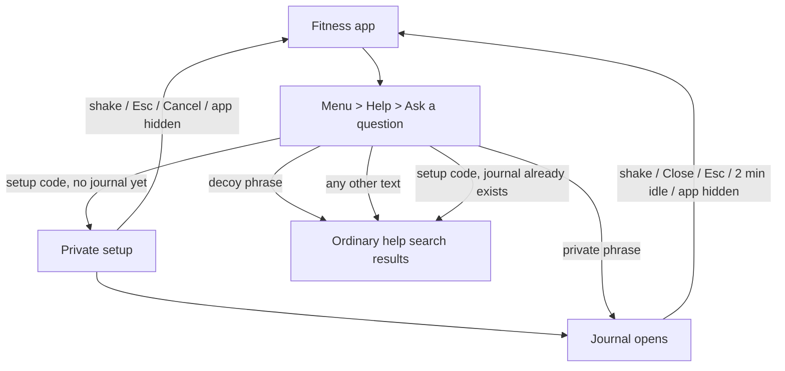

# Shake

**A fitness tracker that hides a private, tamper-evident evidence journal. Everything stays on the phone.**

Hacklanta 2026 · Track: **Cox Sponsored: Social Good** · Side challenge: **Shock Tracker: Zero Data**

| | |
|---|---|
| **Live app** | *https://shake-fit.netlify.app/* |
| **Demo video** | *https://youtu.be/0gVkneUBBo8* |
| **Devpost** | *(add the Devpost link)* |
| **Team** | [@raidathingz](https://github.com/raidathingz) · [@PopaAnastasia](https://github.com/PopaAnastasia) · [@RainaNicole06](https://github.com/RainaNicole06) · [@Zainab-Isa](https://github.com/Zainab-Isa) |

> **Prototype notice.** Shake has not been reviewed by domestic-violence advocates or lawyers, and it is not a substitute for professional help or emergency services. Please use **fake data only** when trying it. If you are in immediate danger, call 911.

> **Changes in this version** are listed in [CHANGES.md](CHANGES.md). The latest round (logo, installing as an app, daily reset, shake fixes) is summarized in [CHANGES-2.md](CHANGES-2.md).

---

## Hackathon track and challenge

**Main track: Cox Sponsored: Social Good.** The track asks us to "build for the people and places that get overlooked: access, safety, mobility, and the everyday systems communities run on."

- **Overlooked people.** People living with abuse are poorly served by tools that assume the phone is safe, the user can make an account, and a cloud is trustworthy.
- **Safety.** The app looks and works like an ordinary fitness tracker. The journal is reachable only with a private phrase, set up only with a code shared in person, and never mentioned anywhere a casual user can see. Shaking the phone closes it instantly.
- **Access.** It is free, needs no account and no app store, works on any phone with a modern browser, installs from a link, and works offline.
- **Everyday systems.** It produces a record that shows whether it was changed after saving, plus a one-time encrypted copy that can be shared with an advocate or lawyer.

**Side challenge: Shock Tracker: Zero Data.** The challenge asks for "a simple, useful tool with no accounts, tracking, profiles, or stored personal info, to prove useful software doesn't need user data."

| Requirement | How Shake meets it |
|---|---|
| No accounts | There is no sign-in of any kind. The hosting service only serves static files. |
| No tracking | No analytics, ads, third-party scripts or fonts, and no network requests for user data (we checked in the browser). |
| No profiles | No profile exists on any server. The Profile page (display name, bio, focus, color, units) is saved only in the user's own browser; we never receive it. |
| No stored personal info | We store none. Everything a person enters stays on their own device, and the journal is encrypted. Nothing is sent to us. Steps come from manual entry or the phone's own motion sensor; we never connect to Apple Health or any health service. |
| Useful without user data | A sensitive tool (private logging, verification, backup and sharing) works with no server at all. |

*How we read "zero data":* zero data collected, sent or held by us. The journal itself is stored on the user's own phone, under their control and encrypted, because that is the product. We want to be upfront about this reading.

## Table of contents

1. [The problem](#1-the-problem)
2. [Our approach](#2-our-approach)
3. [The fitness app (what everyone sees)](#3-the-fitness-app-what-everyone-sees)
4. [The hidden journal](#4-the-hidden-journal)
5. [How a person uses it](#5-how-a-person-uses-it)
6. [How the phrases work (it is not two accounts)](#6-how-the-phrases-work-it-is-not-two-accounts)
7. [How we reach people (distribution)](#7-how-we-reach-people-distribution)
8. [Privacy and security design](#8-privacy-and-security-design)
9. [Evidence integrity: how "cannot be changed" works](#9-evidence-integrity-how-cannot-be-changed-works)
10. [Backup, restore and sharing](#10-backup-restore-and-sharing)
11. [Honest limitations](#11-honest-limitations)
12. [What we tested, and what we did not](#12-what-we-tested-and-what-we-did-not)
13. [Try it (for judges)](#13-try-it-for-judges)
14. [Run it locally](#14-run-it-locally)
15. [Deploy](#15-deploy)
16. [Project structure](#16-project-structure)
17. [Tech stack and attributions](#17-tech-stack-and-attributions)
18. [Roadmap](#18-roadmap)
19. [How this was built](#19-how-this-was-built)

---

## 1. The problem

People living with abuse are often told to document it. The obvious tools are unsafe for exactly that reason:

- A **notes app or camera roll** can be opened by anyone who picks up the phone, and entries can be edited or deleted.
- A **cloud account** can be found, shared with the wrong person, or lose access when a phone is lost.
- A **dedicated "safety" app** on the home screen can itself be a danger if someone checks the phone.
- A **record that anyone can alter** is hard to rely on later, whether with an advocate, a lawyer or a court.

We wanted something that is (1) unremarkable on the home screen, (2) private by design, (3) records that show whether they were changed after saving, and (4) not wiped out when a phone breaks.

## 2. Our approach

Shake is a **working fitness tracker**. Nobody who opens it sees anything else. A private journal is reachable only by typing a personal phrase into the Help page's ordinary search box. There is **no server, no account and no analytics**: data lives encrypted in the phone's browser storage, and the only way it leaves is an encrypted backup file that the user chooses to create.

Three principles drive every decision:

1. **Discretion.** The app never mentions the journal, evidence or abuse anywhere a casual user can see. Wrong phrases, the decoy phrase and the setup code (once used) all behave exactly like a normal help search.
2. **Privacy by architecture.** No backend means nothing to subpoena, breach or leak from our side.
3. **Honesty.** We say *tamper-evident*, not tamper-proof, and we list our limits plainly (see [section 11](#11-honest-limitations)).

## 3. The fitness app (what everyone sees)

Everything here works and saves on the device, so the disguise holds up to someone actually using it. Steps, meals, calories and workouts are **per day**: a new install starts at 0, and each day starts fresh at midnight.

### Layout
- **Brand:** the Shake logo (a lime lightning bolt and a bold white SHAKE on violet `#523ACB`). It is the home-screen and browser-tab icon, and it appears in the Dashboard header.
- **Intro:** on a fresh launch the logo animation plays once (about 3 seconds, tap to skip). It never plays after a quick exit from the journal, and is skipped for people who have reduced motion turned on.
- A colored **header** with the page title, a **menu** button (top left) and the profile initial (top right).
- A **bottom tab bar**: Home, Workouts, Calories, Steps.
- A **side menu** with Dashboard, Workouts, Calorie Tracker, Step Counter, Profile, Settings and Fonts, plus Help and Contact us at the bottom.
- A **welcome tour** on first open that explains only the fitness features.
- On a phone, the app fills the screen. On a laptop or desktop it is shown inside a **phone-shaped frame**, so it looks the same as on a phone (useful for demos).

### Pages
- **Dashboard (Home).** Today's date and a greeting with the person's first name; a progress card with steps against the goal, calories burned and steps left; three quick tiles (step %, calories eaten, workouts logged) that open their pages; a **tip of the day**; and **recent activity** (the last three workouts logged).
- **Workouts.** A workout library (Full Body HIIT, Morning Run, Yoga Flow, Strength Basics) with search, filters (All, Cardio, Flexibility, Strength), duration, type, description and a calorie estimate. **Log workout** adds it to today's activity.
- **Calorie Tracker.** "Add what you ate" with food name, calories, meal (Breakfast, Lunch, Dinner, Snack), protein and fiber; quick-add items; an optional meal photo; totals for calories, protein and fiber; and today's meals with their share of the 2,000 kcal goal. Meals can be removed.
- **Step Counter.**
  - A progress ring with today's steps, percentage and steps to go.
  - **Track a walk:** tap Start walk and the phone's motion sensor counts steps live while the app is open, with a timer. **Finish and add steps** adds them to today; Cancel discards them. The screen is kept awake during a walk where the browser allows it.
  - **Add steps:** type any number and tap Add, or use the quick buttons (+500, +1,000, +2,500).
  - **Set as today's total** (uses the typed number) and **Reset today**.
- **Profile.** Display name, a short bio (140 characters), a focus (Build consistency, Move more, Feel stronger, Rest well), the app's accent color (Violet, Coral, Forest, Navy or any custom color) and units (Imperial or Metric). There is nothing about the journal here.
- **Settings.** Daily step goal (5,000, 8,000, 10,000 or 12,000); an **Add Shake to your Home Screen** card (an Install button on Android, step-by-step Safari instructions on iPhone, hidden once installed); shortcuts to Profile, Text size, Help and Contact; and the app version.
- **Fonts.** Small, Normal or Large text across the app, with a live preview.
- **Help & Support.** Three popular questions and an **Ask a question** box. Search works like a normal help center: if the words match a help article, it shows "Articles that might help" (best match first); if not, it shows **"No matching articles"**, three suggested questions and a **Contact support** button. The question box is also the hidden way into the journal (see below). The typed text is cleared after every search and never shown back on screen.
- **Contact us.** A support email with a Copy button, the usual response time, and a link back to Help.

## 4. The hidden journal

Reached only through Help (see [section 5](#5-how-a-person-uses-it)). It has its own calm, dark-green look and four tabs.

### Log
- **Write a note** or **Paste messages** (for chats and texts), with an optional title and an optional **"When did this happen?"** time that is stored exactly as entered.
- **Photos, audio and video:** Add files, Camera, or **Record audio** in the app.
- **Timestamps on everything:** when the entry was saved (with the phone's time zone), when a file was recorded or last modified, and the optional "happened" time.
- **No edit or delete.** There is no way in the app to change or remove an entry. Before saving, a warning says the entry is final. After saving, the app says **"Log saved"** and asks the person to share an encrypted copy with someone they trust, because the data cannot be recovered if the phone is lost or damaged.
- **Verify entries** re-checks the whole log and reports any change, removal, reordering or altered file.
- **Export PDF** creates a record with times, file fingerprints (SHA-256), the integrity result and the final chain hash.
- **Your entries**, newest first, each with its number, times, text, and Show / play and Download copy buttons for files.

### Backup
- **Create an encrypted backup** and **Restore on a new phone** (see [section 10](#10-backup-restore-and-sharing)).

### Get help
- **911**, the **National Domestic Violence Hotline** (call 1-800-799-7233 or text START to 88788) and the **Georgia Statewide Domestic Violence Hotline** (1-800-334-2836), with tap-to-call and tap-to-text buttons, plus a note about call logs and monitored phones.

### Settings
- **Change phrases:** enter the current private phrase, then a new private phrase (twice) and a new decoy phrase. Saved entries stay readable.
- **Quick exit (shake):** on by default. About three firm shakes close and lock the journal and return straight to the fitness Dashboard. Walking, running, setting the phone down or a gentle wiggle don't trigger it. It can be turned off here. On iPhone, motion access is asked once, by the welcome tour's Get started button (framed as step counting for walks), and quietly renewed on the first tap of every later launch, so shake works as soon as the journal opens. Help search never asks. On iPhone, Safari's own "Shake to Undo" may also pop up an "Undo Typing" box; the journal still closes underneath it, so the box sits on top of the fitness Dashboard and Cancel dismisses it. Text boxes are replaced after each use to make that box less likely.

### Automatic locking
The journal also closes when the person taps **Close** or presses **Esc**, when the app goes to the background (switching apps or tabs), and after **2 minutes** without touching the screen.

## 5. How a person uses it

### Set up (once)
1. Install the app from the link: on iPhone, open it in **Safari → Share → Add to Home Screen**; on Android, **Chrome → ⋮ → Install app** (Menu → Settings in the app shows the same steps). It then opens full screen from its own icon, like any other app.
2. Open **Menu → Help** and type the **setup code** into "Ask a question", then tap Search. The setup code is given in person by an advocate, support group or lawyer (see [section 7](#7-how-we-reach-people-distribution)). For the hackathon build it is `fresh start 26`, set in `src/lib/access.ts`.
3. On the private setup screen, choose a **private phrase** (opens the journal) and a **decoy phrase** (safe to give if pressured). Each needs 8+ characters, and they must differ. Phrases ignore capitalization and extra spaces.
4. Tap **Save and open journal**. On iPhone, tap **Allow** when asked about motion, so shake-to-exit works.
5. From now on, the setup code does nothing special on this phone. It shows ordinary search results like any other text, so it can't reveal that a journal exists.

### Open the journal
1. Open **Menu → Help**, type the private phrase into the question box, and tap Search.
2. The journal opens.
3. If anyone types the **decoy phrase or any other text**, they get ordinary help search results. Nothing differs between a wrong phrase and the decoy, and every search takes about the same moment to finish.

### Record something
1. Write a note, paste messages, or add a photo, audio or video.
2. Optionally add when it happened.
3. Tap **Review and save**, read the warning, and confirm.
4. When "Log saved" appears, choose **Create backup now** and give the file to a trusted person.

### Leave quickly
**Shake the phone**, tap **Close**, press **Esc**, switch apps, or just stop touching it for 2 minutes. The journal locks and only the fitness Dashboard is left on screen. Shake and Esc also work on the private setup screen, which closes without saving anything.



## 6. How the phrases work (it is not two accounts)

There are no accounts at all, no sign-in and nothing on a server. Each phone has **one fitness app and at most one hidden journal**. Three pieces of text matter:

| Text | Who chooses it | What it does |
|---|---|---|
| **Setup code** | Shared in person by a partner organization (`fresh start 26` in this build) | Opens the private setup screen, **only on a phone with no journal yet**. Afterwards it behaves like any other search. |
| **Private phrase** | The person, during setup | Opens their journal. The only way in. |
| **Decoy phrase** | The person, during setup | If someone forces them to "show what's hidden", they can type this one. It shows normal help results, as if nothing is there. It does not open a second journal. |

So it is one journal with one real key, plus a fake key that leads nowhere. To anyone else, the Help box is just a search bar.

## 7. How we reach people (distribution)

Because the app is built to look like a fitness tracker, **it is never advertised as a safety tool to the general public**. A public listing that says "domestic violence evidence app" would defeat the disguise and could endanger the people it is for.

Our intended model is **trusted intermediaries**: advocates, support groups, lawyers, healthcare centers and shelters who already know their clients' safety situations. They introduce the app in person, share the **setup code**, help set up the two phrases, and explain the limits in section 11. To the public, Shake is only a fitness app: the setup screen is reachable only with the setup code, and only on a phone that has no journal yet. This repository and its documentation exist for the hackathon and for those partners. The app itself never mentions any of this.

*Practical notes for partners:* give instructions on plain paper rather than in a message that could be found; help people set up on a phone the abuser does not control; remind them to keep an encrypted backup elsewhere. (We have not yet done partner outreach. See the [roadmap](#18-roadmap).)

## 8. Privacy and security design

**Nothing leaves the device.** There is no backend, no accounts, no analytics, no third-party scripts or fonts, and no network requests for user data. The hosting service only delivers the app's code.

### Unlocking
- The private and decoy phrases are each stretched with **Argon2id** ([hash-wasm](https://github.com/Daninet/hash-wasm), 32 MiB memory, 3 iterations) into a key that wraps a random 256-bit **master key**.
- Two **fixed-size 77-byte header slots** are always stored, in random order. On disk, the real slot and the decoy slot look identical.
- The app **always tries both slots**, so timing does not reveal which phrase matched.
- Every help search takes **at least about one second**, so a phone with no journal (nothing to try) doesn't answer noticeably faster than a phone with one.
- Changing a phrase re-wraps the **same master key**, so existing entries stay readable. The decoy slot has its own unrelated key and contains no entries.
- The unlocked key is a **non-extractable** Web Crypto key held only in memory, and is dropped on lock.

### Setup code
- The setup screen opens only when the setup code is typed **and** no journal exists on the phone. Otherwise the code is treated like any other search text.
- Phrases can't be the same as the setup code.

### Storing entries
- Each entry's text and metadata are encrypted with **AES-GCM** (fresh random IV per item). Files are encrypted separately and are covered by a SHA-256 fingerprint inside the entry.
- Data is stored in **IndexedDB** (via Dexie). Only ciphertext is persisted.
- Phrase fields use masked text inputs instead of password fields, so the browser does not offer to "save the password" and leave a trace.
- Fitness data (steps, meals, workouts, profile) is ordinary, unencrypted local storage, the same as any simple fitness app. It never contains anything from the journal.

### Locking
- Locks when the page is hidden (app switch, tab switch), after **2 minutes of no touches**, on Close, on Esc, and on **shake** (on by default).
- It will **not** lock in the middle of a recording, a save, or a backup. It allows a short grace period while the camera or file picker is open, since those can briefly background the page.

### Motion sensor
- Used for two things only: **shake-to-exit** in the journal and **Track a walk** on the Step Counter. Readings are processed live in the browser and never stored or sent anywhere.
- On iPhone, permission is asked once, from the welcome tour (or Start walk), and renewed silently on the first tap of each launch, as iPhone requires. Nothing in Help or the journal triggers the prompt for someone who has already allowed it. On Android no prompt is needed.

### What we deliberately did not do
- No cloud sync, no accounts, no "magic links", no push notifications, no analytics.
- No connection to Apple Health, Google Fit or any health service.
- No automatic recording. Every recording is started by the user.
- No automatic contact with police or emergency services.

## 9. Evidence integrity: how "cannot be changed" works

Every entry is linked to the one before it, like a chain:

```
entryHash = SHA-256( id | SHA-256(entry contents) | savedAt | previousEntryHash )
```

The first entry links to a fixed starting value. A file's own SHA-256 is part of the entry contents, so the chain covers the photo, audio or video too.

**Verify entries** recalculates everything and reports:
- an edited entry or edited file;
- a missing entry (a gap in the numbering);
- entries moved out of order;
- entries dated earlier than the one before them (the phone's clock may have been changed).

**Immutability in the app.** The code exposes only *add*, *list*, *read a file* and *verify*. There is no function that edits or deletes an entry, and saves are processed one at a time so two quick saves cannot collide. We also removed the earlier "Erase everything" and "simulate tampering" options.

**What this means and does not mean.** It means that anyone using the app has no way to alter the record, and that any change made by other means is *detectable*. It does **not** mean the data is physically unchangeable: see [section 11](#11-honest-limitations). That is why we use the word **tamper-evident** throughout.

**Timestamps.** Times come from the phone's own clock and are labeled that way in the app and the PDF. Independent timestamping (RFC 3161) would add proof of *when* an entry existed, but it needs a third-party service, which conflicts with "nothing leaves the device". It is on the roadmap as an opt-in feature.

## 10. Backup, restore and sharing

A phone can be lost, broken or wiped, and everything here lives only on the phone. So the app prompts for a backup after every save.

**Create a backup** (Journal → Backup → Create backup):
1. The app collects every entry and file and encrypts them into one file named `shake-backup-<date>.dfb`.
2. A random **five-word code** (for example `slight-excite-figure-wet-inch`, 55 bits drawn from the 2,048-word BIP-39 list) is generated and shown **once**. It is never stored.
3. The screen shows the code **first** (step 1 — write it down), then a separate **Download backup file** button (step 2). This order matters on iPhone: saving the file sends the installed app to the background and reloads it, which would wipe the one-time code, so the code must be read before the file is downloaded. The journal does not auto-lock while the code is on screen.
4. The key is derived from the code with **Argon2id** (64 MiB, 3 iterations); the file is sealed with **AES-GCM**, and its header is authenticated.
5. The person gives the file to someone they trust and tells them the code by a **different route** (in person or by phone).

**Open a shared copy** (no account, no install, nothing uploaded): the recipient opens the app link followed by `/#/receive`, chooses the file, and types the code. The page decrypts it in the browser, **re-verifies the whole chain**, shows each entry with its times and files, and can export a PDF.

**Restore onto a new phone:** set up the journal with the setup code (Help → Ask a question), then open Journal → Backup → Restore, choose the file and enter the code. Restore works **only into an empty journal**, so nothing already saved can ever be overwritten, and the original hashes are preserved so verification still passes.

Limits: files up to 50 MB each; a backup up to about 120 MB. A five-word code is strong against guessing for a one-off share, but anyone holding both the file and the code can read it, so keep them apart.

## 11. Honest limitations

We would rather you hear these from us.

| Limitation | What it means |
|---|---|
| **App-level immutability only** | The app offers no edit or delete. Someone with browser developer tools, or who clears the site's data, can still alter or wipe local storage. The hash chain would reveal a change; it cannot prevent one. |
| **No in-app erase, by design** | A person forced to hand over their phone cannot clear the journal from inside the app. Keeping an encrypted backup elsewhere matters for this reason. |
| **Clock is not independently verified** | Entry times come from the device clock. We detect some clock changes but cannot prove the time. |
| **Consistency is not authenticity** | The chain shows entries are unchanged since saving. It does not prove an event happened, or who made the entry. Whether a court accepts it varies; this is not legal advice. |
| **Not undetectable** | An installed app can appear in the app list, storage settings and device backups. Opening a hotline website leaves browser history. Hotline calls can show in phone records. |
| **A watched phone is a risk** | If someone monitors the phone (spyware, a shared account, screen sharing), the journal is not safe from them. |
| **The setup code is shared knowledge** | Anyone who learns the setup code can see that Shake has a private setup screen, but only on a phone with no journal yet. On a phone that has one, the code behaves like any other search, so it never shows whether a journal exists. A real deployment would keep the code (and this README) off public pages. |
| **Storage can be evicted** | Browsers and phones can clear a web app's storage when space is low or the user clears data. Back up. |
| **Phrase strength matters** | A browser has no hardware-backed key store. Argon2id slows guessing, but short or common phrases remain weak. |
| **iPhone Shake to Undo** | Safari keeps iPhone's built-in "Shake to Undo" on, and a web app can't switch it off (native apps can). After typing, a shake may also show an "Undo Typing" box. The journal still closes underneath, so the box appears over the fitness Dashboard and Cancel dismisses it. Text boxes are replaced after each use to make it less likely. A native wrapper (roadmap) would remove it completely. |
| **Walk mode only counts while open** | A web app can't count steps in the background or read Apple Health. Track a walk counts only while Shake is open on screen; accuracy depends on how the phone is held. |
| **Real-device quirks** | Recording, shake and walk mode behave differently on iPhone and Android (permissions, backgrounding). iPhone requires a motion-permission prompt. |
| **No expert review yet** | Not reviewed by domestic-violence advocates or lawyers. Recording-consent laws vary by state (Georgia is one-party consent). Ask a professional. |

## 12. What we tested, and what we did not

**Automated tests we ran** (Node, with an in-memory IndexedDB):
- Unlocking: private phrase, decoy phrase, wrong phrase, changed phrases keep entries readable, wrong "current" phrase is refused.
- Saving: notes and files, time fields present, 4 concurrent saves produce a valid chain.
- Tamper detection: edited entry text, edited file bytes, removed entry, reordered entries, direct edits to IndexedDB, and a deleted row are all caught.
- Backup: round-trip with correct code, wrong code rejected, flipped byte rejected, flipped header rejected, garbage rejected.
- Restore in a second, fresh process: verifies without a vault (Receive path), restores into an empty journal, refuses a non-empty one, and can append afterward with the chain intact.
- PDF export builds a valid file, including text with non-Latin-1 characters.
- Shake detector fires on about three firm shakes within a second or so, and not on a still phone, walking, running, a single drop or a gentle wiggle.
- Step detector counts simulated slow walking, walking and running at the right cadence, and counts nothing when the phone is still.

**Browser tests (latest version):**
- The build succeeds with no TypeScript errors, and there are no console errors.
- Help search: matching words show related articles; unrelated text shows "No matching articles" with suggestions and Contact support.
- Setup code opens setup on a fresh phone → set phrases → journal opens → save a note → "Log saved" → Verify entries.
- Change phrases inside the journal; afterwards the old phrase, the decoy phrase and the setup code all show normal search results, and the new phrase opens the journal with entries intact.
- A simulated shake inside the journal returns to the fitness Dashboard.
- Step Counter: typed amounts add correctly; a simulated walk is counted and added to today's total.
- Every page checked at phone size, and in the phone frame at laptop size.

**Not yet tested:**
- Shake, walk mode and audio recording **on real phones**, especially iPhone Safari.
- HEIC and other uncommon photo formats from phones.
- Behavior under storage eviction, or on very old browsers.
- Any user testing with real people, and any independent security audit.

## 13. Try it (for judges)

Please use fake data.

1. Open the live link on a phone and add it to the home screen (iPhone: Safari → Share → Add to Home Screen; Android: Chrome → ⋮ → Install app). (On a laptop, the app appears in a phone frame.)
2. Explore the fitness app: log a workout, add a meal, add steps with your own number, try **Track a walk** (phone only), change the step goal and the app color.
3. **Menu → Help:** type "step goal" and Search: real matching articles. Type something random: "No matching articles" with suggestions.
4. Type the setup code `fresh start 26` and Search. Set a private phrase and a different decoy phrase, 8+ characters each, then **Save and open journal**.
5. Add a note, choose **Review and save**, read the warning, confirm, and see "Log saved".
6. Add a photo or record audio. Check the *Saved*, *File dated* or *Recorded* times.
7. Press **Verify entries**.
8. **Backup → Create backup.** Note the five-word code.
9. In a second tab or browser, open `<link>/#/receive`, choose the `.dfb` file and enter the code. Check the integrity message and entries. Try **Export PDF**.
10. Open **Get help** to see the hotline list, and **Settings** to see Change phrases and Quick exit.
11. On a phone, **shake it firmly** (about three quick shakes): the journal closes and the fitness Dashboard is back.
12. Back in **Help**, type the **decoy** phrase, then the setup code again: both show ordinary results. Type the **private** phrase: the journal opens.
13. Leave the journal untouched for 2 minutes (or switch apps) and watch it lock.

*Note on testing in a desktop browser:* the app needs a secure context (HTTPS or `localhost`) for encryption to work. Shake and walk mode need a real phone.

## 14. Run it locally

Requires Node.js 20 or newer ([nodejs.org](https://nodejs.org), LTS installer).

```bash
git clone https://github.com/PopaAnastasia/CLAUDE-S-PLAN.git
cd CLAUDE-S-PLAN
npm install
npm run dev        # development server (usually http://localhost:5173)
npm run build      # type-check and build into dist/
npm run preview    # serve the built app locally
npm run lint       # oxlint
```

A phone cannot use the `http://192.168...` network address for this app, because encryption, installation and motion access require HTTPS. To test on a phone, deploy the build (below), or use `localhost` through USB debugging on Android.

To start over while testing on a computer: browser DevTools → **Application → Storage → Clear site data**, then refresh.

## 15. Deploy

The app is static, so any static host works. We use **Netlify**:

1. Connect the GitHub repository (or drag the `dist` folder onto [Netlify Drop](https://app.netlify.com/drop)).
2. Build command `npm run build`, publish directory `dist`.
3. Open the HTTPS link on a phone and choose Add to Home Screen.

The web app manifest (name **Shake**, violet theme), icons (192, 512, maskable, Apple touch, all using the lightning-bolt logo) and service worker are generated by `vite-plugin-pwa`. The service worker caches only the app's static files (including the intro video) so it opens offline; it does not cache any user data, which lives in IndexedDB.

## 16. Project structure

```
src/
  App.tsx                    # screens (fitness, setup, journal), /#/receive route, auto-lock timers
  index.css                  # Tailwind, plus the phone frame on wide screens
  assets/logo.png            # Shake logo for the Dashboard header
  components/
    FitnessApp.tsx           # the disguise: header, menu, tabs, Help search, Contact
    Dashboard.tsx            # Dashboard and Workouts
    Trackers.tsx             # Calories, Step Counter (walk mode, add steps), Settings, Fonts
    Bar.tsx, data.ts         # progress bar; page list, workouts, shared fitness styles
    ProfilePage.tsx          # name, bio, focus, app color, units
    WelcomeTour.tsx          # first-launch fitness walkthrough
    Splash.tsx               # logo intro on launch (once per session, tap to skip)
    Phrases.tsx              # private setup screen and Change phrases
    VaultHome.tsx            # the journal (Log, Backup, Get help, Settings)
    EntryCard.tsx, Dialogs.tsx, Backup.tsx, Resources.tsx, ReceivePage.tsx
    ui.ts                    # shared styles for the private screens
  crypto/vault.ts            # two-slot vault, Argon2id key wrapping, phrase changes
  storage/evidence.ts        # IndexedDB log: add, list, read file, verify, restore (no edit/delete)
  lib/
    access.ts                # setup code (works only before a journal exists)
    chain.ts, hash.ts        # hash chain and verification
    bundle.ts, words.ts      # encrypted backup format, five-word codes
    exportPdf.ts, format.ts  # PDF record, time formatting
    useShake.ts              # shake-to-exit (on by default) and motion permission
    useWalk.ts               # live step counting for Track a walk
    lockGrace.ts             # lock timing around camera, file picker and saves
public/                      # app icons (bolt logo), favicon, logo intro video (intro.webm, intro.mp4)
CHANGES.md                   # what changed in this version
CHANGES-2.md                 # the latest round of changes
```

## 17. Tech stack and attributions

| Layer | Choice |
|---|---|
| UI | React 19, TypeScript, Vite, Tailwind CSS 4, lucide-react icons |
| PWA | vite-plugin-pwa (Workbox) |
| Storage | IndexedDB through Dexie |
| Cryptography | Web Crypto API (AES-GCM, SHA-256) and hash-wasm (Argon2id) |
| Sensors | DeviceMotion API (shake-to-exit, walk mode), Screen Wake Lock API (walk mode) |
| PDF | pdf-lib |
| Hosting | Netlify (static) |

- The five-word codes use the **BIP-39 English word list** via `@scure/bip39` (MIT license, Paul Miller), copied into `src/lib/words.ts` with an attribution comment.
- All other dependencies are open source under their own licenses; see `package.json`.

## 18. Roadmap

Things we would do next, in rough priority:

1. **Advocate and legal review** of the design, wording and recording-consent notices before any real use.
2. **Partner pilot** with a shelter, healthcare center or support group, including a plain-paper handout, in-person setup and per-partner setup codes.
3. **Native wrapper** (for example Capacitor) so Shake can own the shake gesture (no iPhone "Shake to Undo" popup), read steps from **Apple Health / Health Connect**, count steps in the background, and offer background recording shortcuts.
4. **On-device transcription** of audio and video, opt-in, stored as a separate linked entry labeled machine-generated, never replacing the original. This means downloading a speech model, so it would be the app's first optional network request and needs a clear explanation.
5. **Independent timestamps** (RFC 3161), opt-in, so a time can be proven beyond the phone's clock.
6. **Real-device hardening:** iPhone and Android testing for recording, shake, walk mode, install and storage persistence.
7. **Safer device-to-device sharing** with expiring links. This needs a server, which conflicts with "nothing leaves the device", so it needs careful design.
8. **More disguises.**
9. **Security audit** and a written threat model.

## 19. How this was built

**Team work.** We made the product, safety and architecture decisions: the fitness-app disguise, entering the journal through the Help question box, the decoy phrase that looks identical to any other input, keeping setup behind a code shared by partners, no backend, entries that cannot be edited or deleted, no erase option, and encrypted backup instead of cloud sync. We built and iterated on the interface and the fitness features, set up the project and PWA, worked through branches, pull requests and merges in Git, debugged build and environment problems, ran the app in browsers and on phones, and deployed it.

**AI assistance.** We used an AI coding assistant (Claude) under our direction. It helped write and test parts of the code, in particular the encrypted storage, the hash chain, the backup format, the automated tests listed in [section 12](#12-what-we-tested-and-what-we-did-not), and, in this version, the setup-code flow, the help search results, walk mode and the visual redesign. We did product and safety decisions, the interface, version control with branches and pull requests, debugging, testing in browsers, and deploying. The project idea was completely original and was not developed using AI.

**Before the event vs. during it.** Everything, including idea generation and developing, was started after the official Hackathon coding window began.

---

*Shake is a hackathon prototype. If you or someone you know is experiencing abuse, the National Domestic Violence Hotline is available 24/7 at 1-800-799-7233 (text START to 88788). In Georgia: 1-800-334-2836. In an emergency, call 911.*
