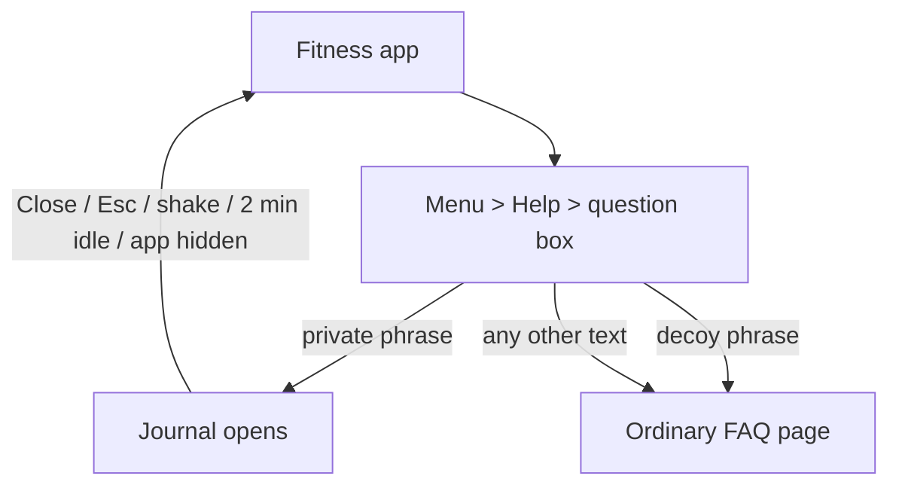

# Daily Fit

**A fitness tracker that hides a private, tamper-evident evidence journal. Everything stays on the phone.**

Hacklanta 2026 · Track: Cox Social Good *(TODO: confirm track and list only the sponsor challenges we are genuinely entering)*

| | |
|---|---|
| **Live app** | TODO: paste the Netlify link |
| **Demo video** | TODO: paste the public video link |
| **Devpost** | TODO: paste the Devpost link |
| **Team** | [@raidathingz](https://github.com/raidathingz) · [@PopaAnastasia](https://github.com/PopaAnastasia) · [@RainaNicole06](https://github.com/RainaNicole06) |

> **Prototype notice.** Daily Fit has not been reviewed by domestic-violence advocates or lawyers, and it is not a substitute for professional help or emergency services. Please use **fake data only** when trying it. If you are in immediate danger, call 911.

---

## Table of contents

1. [The problem](#1-the-problem)
2. [Our approach](#2-our-approach)
3. [What it does](#3-what-it-does)
4. [How a person uses it](#4-how-a-person-uses-it)
5. [How we reach people (distribution)](#5-how-we-reach-people-distribution)
6. [Privacy and security design](#6-privacy-and-security-design)
7. [Evidence integrity: how "cannot be changed" works](#7-evidence-integrity-how-cannot-be-changed-works)
8. [Backup, restore and sharing](#8-backup-restore-and-sharing)
9. [Honest limitations](#9-honest-limitations)
10. [What we tested, and what we did not](#10-what-we-tested-and-what-we-did-not)
11. [Try it (for judges)](#11-try-it-for-judges)
12. [Run it locally](#12-run-it-locally)
13. [Deploy](#13-deploy)
14. [Project structure](#14-project-structure)
15. [Tech stack and attributions](#15-tech-stack-and-attributions)
16. [Roadmap](#16-roadmap)
17. [How this was built (disclosure)](#17-how-this-was-built-disclosure)

---

## 1. The problem

People living with abuse are often told to document it. The obvious tools are unsafe for exactly that reason:

- A **notes app or camera roll** can be opened by anyone who picks up the phone, and entries can be edited or deleted.
- A **cloud account** can be found, shared with the wrong person, or lose access when a phone is lost.
- A **dedicated "safety" app** on the home screen can itself be a danger if someone checks the phone.
- A **record that anyone can alter** is hard to rely on later, whether with an advocate, a lawyer or a court.

We wanted something that is (1) unremarkable on the home screen, (2) private by design, (3) records that show whether they were changed after saving, and (4) not wiped out when a phone breaks.

## 2. Our approach

Daily Fit is a **working fitness tracker**. Nobody who opens it sees anything else. A private journal is reachable only by typing a personal phrase into an ordinary-looking box. There is **no server, no account and no analytics**: data lives encrypted in the phone's browser storage, and the only way it leaves is an encrypted backup file that the user chooses to create.

Three principles drive every decision:

1. **Discretion.** The app never mentions the journal, evidence or abuse anywhere a casual user can see.
2. **Privacy by architecture.** No backend means nothing to subpoena, breach or leak from our side.
3. **Honesty.** We say *tamper-evident*, not tamper-proof, and we list our limits plainly (see [section 9](#9-honest-limitations)).

## 3. What it does

### The disguise: a real fitness app
- **Dashboard** with steps, calories and recent activity.
- **Workouts**, **Calorie tracker** and **Step counter** that save data locally.
- **Settings and fonts**, plus **Profile** with display name, bio, focus, app color, units, and a *Passwords* section (collapsed by default).
- **Help and Contact** pages with a question box and a normal FAQ.
- A **welcome tour** on first open that explains only the fitness features.

### The hidden journal
Reached through Help (see [section 4](#4-how-a-person-uses-it)). Inside:

- **Notes** and **pasted chats or messages**, with an optional "When did this happen?" time that is stored exactly as entered.
- **Photos, audio and video**, from the file picker, the camera, or an in-app audio recorder.
- **Timestamps on everything:** when the entry was saved (with the phone's time zone), when a file was recorded or last modified, and the optional "happened" time.
- **No edit or delete.** There is no way in the app to change or remove an entry. Before saving, a warning says the entry is final. After saving, the app says "Log saved" and asks the person to share an encrypted copy with someone they trust, because the data cannot be recovered if the phone is lost or damaged.
- **Verify entries** re-checks the whole log and reports any change, removal, reordering or altered file.
- **Export PDF** creates a record with times, file fingerprints (SHA-256), the integrity result and the final chain hash.
- **Backup** (create or restore) and a **Receive** page for a trusted person to open a shared copy.
- **Resources** tab: 911, the National Domestic Violence Hotline and the Georgia Statewide Domestic Violence Hotline, with tap-to-call, plus a note about call logs and monitored phones.
- **Quick-exit shake** (optional): shaking the phone closes and locks the journal.
- **Automatic locking** after 2 minutes without touching the screen, and whenever the app goes to the background.

## 4. How a person uses it

### Set up (once)
1. Install the app from the link ("Add to Home Screen").
2. Open **Menu → Profile → Passwords**.
3. Enter a **new password** (this is the private phrase that opens the journal) and a **recovery password** (the decoy). Each needs 8+ characters, and they must differ. Phrases ignore capitalization and extra spaces.

### Open the journal
1. Open **Menu → Help** and type the private phrase into the question box, then press Search.
2. The journal opens immediately. There is no artificial delay.
3. If anyone types the **decoy phrase or any other text**, they see the same ordinary FAQ page. Nothing differs between a wrong phrase and the decoy.

### Record something
1. Write a note, paste a chat, or add a photo, audio or video.
2. Optionally add when it happened.
3. Press **Review and save**, read the warning, and confirm.
4. When "Log saved" appears, choose **Create backup now** and give the file to a trusted person.

### Leave quickly
Press **Close**, press **Esc**, shake the phone (if turned on), or just stop touching it: it locks itself.



## 5. How we reach people (distribution)

Because the app is built to look like a fitness tracker, **it is never advertised as a safety tool to the general public**. A public listing that says "domestic violence evidence app" would defeat the disguise and could endanger the people it is for.

Our intended model is **trusted intermediaries**: advocates, support groups, healthcare centers and shelters who already know their clients' safety situations. They introduce the app in person, help set up the two phrases, and explain the limits in section 9. This repository and its documentation exist for the hackathon and for those partners. The app itself never mentions any of this.

*Practical notes for partners:* give instructions on plain paper rather than in a message that could be found; help people set up on a phone the abuser does not control; remind them to keep an encrypted backup elsewhere. (We have not yet done partner outreach. See the [roadmap](#16-roadmap).)

## 6. Privacy and security design

**Nothing leaves the device.** There is no backend, no accounts, no analytics, no third-party scripts or fonts, and no network requests for user data. The hosting service only delivers the app's code.

### Unlocking
- The private and decoy phrases are each stretched with **Argon2id** ([hash-wasm](https://github.com/Daninet/hash-wasm), 32 MiB memory, 3 iterations) into a key that wraps a random 256-bit **master key**.
- Two **fixed-size 77-byte header slots** are always stored, in random order. If no decoy was set, its slot is random bytes of the same size. On disk, the real vault, the decoy and the filler look identical.
- The app **always tries both slots**, so timing does not reveal which phrase matched.
- Changing a phrase re-wraps the **same master key**, so existing entries stay readable. The decoy slot has its own unrelated key and contains no entries.
- The unlocked key is a **non-extractable** Web Crypto key held only in memory, and is dropped on lock.

### Storing entries
- Each entry's text and metadata are encrypted with **AES-GCM** (fresh random IV per item). Files are encrypted separately and are covered by a SHA-256 fingerprint inside the entry.
- Data is stored in **IndexedDB** (via Dexie). Only ciphertext is persisted.
- Phrase fields use masked text inputs instead of password fields, so the browser does not offer to "save the password" and leave a trace.

### Locking
- Locks when the page is hidden (app switch, tab switch), after **2 minutes of no touches**, on Close, on Esc, and on shake.
- It will **not** lock in the middle of a recording, a save, or a backup. It allows a short grace period while the camera or file picker is open, since those can briefly background the page.

### What we deliberately did not do
- No cloud sync, no accounts, no "magic links", no push notifications, no analytics.
- No automatic recording. Every recording is started by the user.
- No automatic contact with police or emergency services.

## 7. Evidence integrity: how "cannot be changed" works

Every entry is linked to the one before it, like a chain:

```
entryHash = SHA-256( id | SHA-256(entry contents) | savedAt | previousEntryHash )
```

The first entry links to a fixed starting value. A file's own SHA-256 is part of the entry contents, so the chain covers the photo, audio or video too.

**Verify entries** recalculates everything and reports:
- an edited entry or edited file;
- a missing entry (a gap in the numbering);
- entries moved out of order;
- entries dated earlier than the one before them (the phone's clock may have been changed).

**Immutability in the app.** The code exposes only *add*, *list*, *read a file* and *verify*. There is no function that edits or deletes an entry, and saves are processed one at a time so two quick saves cannot collide. We also removed the earlier "Erase everything" and "simulate tampering" options.

**What this means and does not mean.** It means that anyone using the app has no way to alter the record, and that any change made by other means is *detectable*. It does **not** mean the data is physically unchangeable: see [section 9](#9-honest-limitations). That is why we use the word **tamper-evident** throughout.

**Timestamps.** Times come from the phone's own clock and are labeled that way in the app and the PDF. Independent timestamping (RFC 3161) would add proof of *when* an entry existed, but it needs a third-party service, which conflicts with "nothing leaves the device". It is on the roadmap as an opt-in feature.

## 8. Backup, restore and sharing

A phone can be lost, broken or wiped, and everything here lives only on the phone. So the app prompts for a backup after every save.

**Create a backup** (Journal → Backup):
1. The app collects every entry and file and encrypts them into one `.dfb` file.
2. A random **five-word code** (for example `slight-excite-figure-wet-inch`, 55 bits drawn from the 2,048-word BIP-39 list) is generated and shown **once**. It is never stored.
3. The key is derived from the code with **Argon2id** (64 MiB, 3 iterations); the file is sealed with **AES-GCM**, and its header is authenticated.
4. The person gives the file to someone they trust and tells them the code by a **different route** (in person or by phone).

**Open a shared copy** (no account, no install, nothing uploaded): the recipient opens the app link followed by `/#/receive`, chooses the file, and types the code. The page decrypts it in the browser, **re-verifies the whole chain**, shows each entry with its times and files, and can export a PDF.

**Restore onto a new phone:** set phrases in Profile, open Journal → Backup → Restore, choose the file and enter the code. Restore works **only into an empty journal**, so nothing already saved can ever be overwritten, and the original hashes are preserved so verification still passes.

Limits: files up to 50 MB each; a backup up to about 120 MB. A five-word code is strong against guessing for a one-off share, but anyone holding both the file and the code can read it, so keep them apart.

## 9. Honest limitations

We would rather you hear these from us.

| Limitation | What it means |
|---|---|
| **App-level immutability only** | The app offers no edit or delete. Someone with browser developer tools, or who clears the site's data, can still alter or wipe local storage. The hash chain would reveal a change; it cannot prevent one. |
| **No in-app erase, by design** | A person forced to hand over their phone cannot clear the journal from inside the app. Keeping an encrypted backup elsewhere matters for this reason. |
| **Clock is not independently verified** | Entry times come from the device clock. We detect some clock changes but cannot prove the time. |
| **Consistency is not authenticity** | The chain shows entries are unchanged since saving. It does not prove an event happened, or who made the entry. Whether a court accepts it varies; this is not legal advice. |
| **Not undetectable** | An installed app can appear in the app list, storage settings and device backups. Opening a hotline website leaves browser history. Hotline calls can show in phone records. |
| **A watched phone is a risk** | If someone monitors the phone (spyware, a shared account, screen sharing), the journal is not safe from them. |
| **Storage can be evicted** | Browsers and phones can clear a web app's storage when space is low or the user clears data. Back up. |
| **Phrase strength matters** | A browser has no hardware-backed key store. Argon2id slows guessing, but short or common phrases remain weak. |
| **Real-device quirks** | Recording and shake behave differently on iPhone and Android (permissions, backgrounding). iPhone requires a motion-permission prompt for shake. |
| **No expert review yet** | Not reviewed by domestic-violence advocates or lawyers. Recording-consent laws vary by state (Georgia is one-party consent). Ask a professional. |

## 10. What we tested, and what we did not

**Automated tests we ran** (Node, with an in-memory IndexedDB):
- Unlocking: private phrase, decoy phrase, wrong phrase, changed phrases keep entries readable, wrong "current" phrase is refused.
- Saving: notes and files, time fields present, 4 concurrent saves produce a valid chain.
- Tamper detection: edited entry text, edited file bytes, removed entry, reordered entries, direct edits to IndexedDB, and a deleted row are all caught.
- Backup: round-trip with correct code, wrong code rejected, flipped byte rejected, flipped header rejected, garbage rejected.
- Restore in a second, fresh process: verifies without a vault (Receive path), restores into an empty journal, refuses a non-empty one, and can append afterward with the chain intact.
- PDF export builds a valid file, including text with non-Latin-1 characters.
- Shake detector fires on firm repeated jolts, not on rest or slow bumps.

**Browser tests:** the build succeeds with no TypeScript errors; the journal flow (warning, "Log saved", list, verify, resources, backup, close), the Receive page, Profile and the welcome tour run in a real browser with no console errors and no external network requests.

**Not yet tested:**
- Shake and audio recording **on real phones**, especially iPhone Safari.
- HEIC and other uncommon photo formats from phones.
- Behavior under storage eviction, or on very old browsers.
- Any user testing with real people, and any independent security audit.

## 11. Try it (for judges)

Please use fake data.

1. Open the live link on a phone and choose **Add to Home Screen**.
2. Explore the fitness app: log a workout, add food, change a step goal.
3. **Menu → Profile → Passwords:** set a private phrase and a different recovery (decoy) phrase, 8+ characters each, then Save.
4. **Menu → Help:** type the **decoy** phrase and Search. You get an ordinary FAQ page. Try random text: same page.
5. Type the **private** phrase. The journal opens.
6. Add a note, choose **Review and save**, read the warning, confirm, and see "Log saved".
7. Add a photo or record audio. Check the *Saved*, *File dated* or *Recorded* times.
8. Press **Verify entries**.
9. **Backup → Create backup.** Note the five-word code.
10. In a second tab or browser, open `<link>/#/receive`, choose the `.dfb` file and enter the code. Check the integrity message and entries. Try **Export PDF**.
11. Open **Resources** to see the hotline list.
12. Leave the journal untouched for 2 minutes (or switch apps) and watch it lock. Optionally tick *Quick exit* and shake the phone.

*Note on testing in a desktop browser:* the app needs a secure context (HTTPS or `localhost`) for encryption to work.

## 12. Run it locally

Requires Node.js 20 or newer.

```bash
git clone https://github.com/PopaAnastasia/CLAUDE-S-PLAN.git
cd CLAUDE-S-PLAN
npm install
npm run dev        # development server (usually http://localhost:5173)
npm run build      # type-check and build into dist/
npm run preview    # serve the built app locally
```

A phone cannot use the `http://192.168...` network address for this app, because encryption and installation require HTTPS. To test on a phone, deploy the build (below), or use `localhost` through USB debugging on Android.

## 13. Deploy

The app is static, so any static host works. We use **Netlify**:

1. Connect the GitHub repository (or drag the `dist` folder onto Netlify Drop).
2. Build command `npm run build`, publish directory `dist`.
3. Open the HTTPS link on a phone and choose Add to Home Screen.

The web app manifest, icons (192, 512, maskable, Apple touch) and service worker are generated by `vite-plugin-pwa`. The service worker caches only the app's static files so it opens offline; it does not cache any user data, which lives in IndexedDB.

## 14. Project structure

```
src/
  App.tsx                    # screens, hash route for /#/receive, auto-lock timers
  components/
    FitnessApp.tsx           # the disguise: shell, menu, Help, Contact
    Dashboard.tsx, Trackers.tsx, Bar.tsx, data.ts   # fitness features and data
    ProfilePage.tsx          # profile, units, color, collapsed Passwords section
    FaqPage.tsx              # the page shown for decoy or any other text
    WelcomeTour.tsx          # first-launch fitness walkthrough
    VaultHome.tsx            # the journal (log, backup, resources)
    EntryCard.tsx, Dialogs.tsx, Backup.tsx, Resources.tsx, ReceivePage.tsx
  crypto/vault.ts            # two-slot vault, Argon2id key wrapping, phrase changes
  storage/evidence.ts        # IndexedDB log: add, list, read file, verify, restore (no edit/delete)
  lib/
    chain.ts, hash.ts        # hash chain and verification
    bundle.ts, words.ts      # encrypted backup format, five-word codes
    exportPdf.ts, format.ts  # PDF record, time formatting
    useShake.ts, lockGrace.ts# quick exit, lock timing
public/                      # PWA icons
docs/SPEC.md                 # our original build spec (kept for reference)
```

## 15. Tech stack and attributions

| Layer | Choice |
|---|---|
| UI | React 19, TypeScript, Vite, Tailwind CSS 4, lucide-react icons |
| PWA | vite-plugin-pwa (Workbox) |
| Storage | IndexedDB through Dexie |
| Cryptography | Web Crypto API (AES-GCM, SHA-256) and hash-wasm (Argon2id) |
| PDF | pdf-lib |
| Hosting | Netlify (static) |

- The five-word codes use the **BIP-39 English word list** via `@scure/bip39` (MIT license, Paul Miller), copied into `src/lib/words.ts` with an attribution comment.
- All other dependencies are open source under their own licenses; see `package.json`.

## 16. Roadmap

Things we would do next, in rough priority:

1. **Advocate and legal review** of the design, wording and recording-consent notices before any real use.
2. **Partner pilot** with a shelter, healthcare center or support group, including a plain-paper handout and in-person setup.
3. **On-device transcription** of audio and video, opt-in, stored as a separate linked entry labeled machine-generated, never replacing the original. This means downloading a speech model, so it would be the app's first optional network request and needs a clear explanation.
4. **Independent timestamps** (RFC 3161), opt-in, so a time can be proven beyond the phone's clock.
5. **Real-device hardening:** iPhone and Android testing for recording, shake, install and storage persistence.
6. **Safer device-to-device sharing** with expiring links. This needs a server, which conflicts with "nothing leaves the device", so it needs careful design.
7. **More disguises** and a native wrapper for background shortcuts.
8. **Security audit** and a written threat model.

## 17. How this was built (disclosure)

TODO (team): check the Hacklanta rules on pre-existing work and state it here exactly. For example: *what existed before the event* (our written spec and early scaffold) and *what we built during it* (the working app, tests and this documentation).

An AI coding assistant (Claude) helped design, write and test code and documentation. The team directed the product decisions, ran and tested the app, and reviewed the results. Security-critical code (vault, encryption, hash chain, backup format) was tested with the automated tests listed in [section 10](#10-what-we-tested-and-what-we-did-not), but has **not** had an independent audit.

---

*Daily Fit is a hackathon prototype. If you or someone you know is experiencing abuse, the National Domestic Violence Hotline is available 24/7 at 1-800-799-7233 (text START to 88788). In Georgia: 1-800-334-2836. In an emergency, call 911.*
